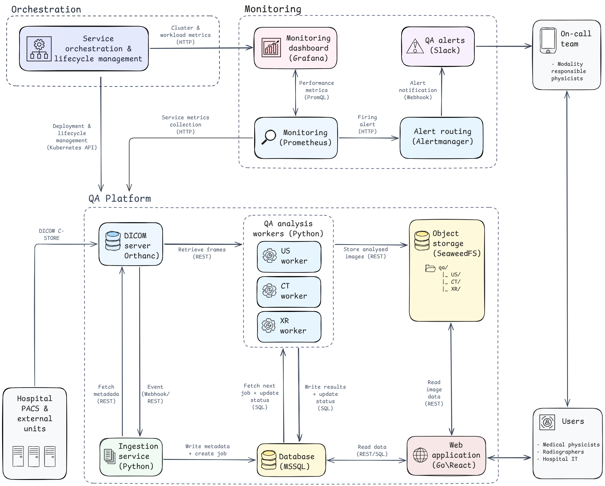

# RadiQA Architecture

RadiQA is a cloud-native, **event-driven** framework for the **automated quality assurance (QA) of medical imaging** in multi-institutional healthcare environments. It receives DICOM images from a hospital PACS through an Orthanc [1] DICOM server, runs modality-specific QA analysis (ultrasound, X-ray, CT, angiography), stores the results in Microsoft SQL Server [3], and presents them through a Go [5] + React [8] web application with trend visualization, editable tolerance limits and AI-assisted reporting.

This document describes **what the system is and how the pieces fit together**. For a hands-on install guide see [`README.md`](readme.md).

---

## Contents

1. [Key features](#1-Key-features)
2. [The event-driven pipeline](#2-the-event-driven-pipeline)
3. [Components](#3-components)
4. [Supported modalities](#4-supported-modalities)
5. [Data model and storage](#5-data-model-and-storage)
6. [Technology stack](#6-technology-stack)
7. [Deployment topology](#7-deployment-topology)
8. [Security posture](#8-security-posture)
9. [References](#9-references)

---

## 1. High-level architecture

*Data-flow diagram: PACS -> Orthanc -> ingestion -> SQL Server + Service Broker -> event workers -> S3 / Go backend -> browser. Bracketed numbers map to the technology references in section 9.*

Key features:

- **Decoupled ingestion and analysis.** 
  - The PACS/Orthanc side only *enqueues work*. 
  - analysis happens asynchronously in workers that can be scaled independently.
- **The database is the source of truth, Service Broker is only a doorbell.** 
  - A lost or duplicated wake-up message can never lose or double-run a job (see section 2).
- **Competing consumers.** 
  - Multiple replicas of a worker share the queue without any manual sharding; `READPAST` lets each worker skip rows another has already locked.
- **All UI analysis images in object storage.** 
  - Every analysis image rendered in the UI is stored in S3-compatible object storage [4] and served by the Go backend. Legacy X-ray/CT rows written before the migration remain as SQL Server BLOBs and are still served through a fallback read path.

---

## 2. The event-driven pipeline

**1. Trigger.** 
- When a study becomes stable in Orthanc, its `OnStableStudy` event fires a Python plugin (`ingestion-service/orthanc/autoqad_ingest.py`) that POSTs the study id to the ingestion service. 
- A `.lua` variant is kept as a fallback; the Python plugin is the validated path because Orthanc's built-in Lua HTTP client does not reliably emit outbound requests in all environments.

**2. Ingestion.** 
- The FastAPI [2] ingestion service enumerates the study over Orthanc REST, determines the modality of each series, and inserts `QUEUED` rows into the per-modality job tables. 
- Insertion is **idempotent** (`UNIQUE(orthanc_id)`), so re-delivery of the same study never creates duplicate jobs.

**3. Doorbell.** 
- An `AFTER INSERT` trigger sends a message on the matching SQL Server **Service Broker** queue [3]. This only *wakes* a worker, it carries no authoritative state.

**4. Claim.** 
- A worker blocked on `WAITFOR RECEIVE` wakes, first **reclaims** any expired `CLAIMED`/`RUNNING` jobs (whose owning worker died, `claimed_at < now - CLAIM_TIMEOUT`), then **atomically claims** one `QUEUED` job with `UPDATE ... WITH (READPAST, ROWLOCK, UPDLOCK)`.
- The job state machine is `QUEUED -> CLAIMED -> RUNNING -> COMPLETED | FAILED`.

**5. Analyse.** 
- The worker fetches the DICOM from Orthanc over REST, runs the modality-specific analysis, writes results to the modality result table, uploads any analysis images to S3 (SeaweedFS), and marks the job `COMPLETED` (or `FAILED` with an
`error_message` kept for the *Measurements* view).

---
## 3. Components

Ports are shown as `host → container`. Everything runs on the `autoqad-net` Podman network.

| Component | Tech | Path | Port |
|---|---|---|---|
| **DICOM server** | Orthanc [1] | `services/Orthanc/`, plugin in `ingestion-service/orthanc/` | 14242→4242 (DICOM), 18042→8042 (REST) |
| **Ingestion service** | FastAPI [2] / Python | `ingestion-service/` | 8070→8000 |
| **MS SQL Server** | SQL Server 2022 + Service Broker [3] | schemas in `scripts/` | 11433→1433 |
| **Object storage** | SeaweedFS [4] (S3-compatible) | config generated from `.env` | 8333 |
| **US event worker** | Python, custom analysis | `services/Analyze_service/worker_us_eventdriven.py` | internal |
| **XR event worker** | Python, `normi13_qa` [14] / pylinac [13] | `services/Xray_analyze_service/worker_xr_eventdriven.py` | internal |
| **CT event worker** | Python, pylinac CatPhan [13] | `services/CT_analyze_service/worker_ct_eventdriven.py` | internal |
| **Angio event worker** | Python, pylinac Leeds TOR [13] | `services/Angio_analyze_service/worker_angio_eventdriven.py` | internal |
| **Image service** | Python (US straighten/crop) | `services/Image_service/` | 8090→8090 |
| **Go backend** | Go [5], Chi [5], go-mssqldb [6], aws-sdk-go-v2 [7] | `go-backend/` | 8081→8080 |
| **React SPA** | React [8] + Vite + TypeScript, TanStack Query [9], Recharts [10], Tailwind [11] | `frontend/` (built into the Go image) | 5174 (dev) |
| **Caddy** | Caddy 2 [17] (reverse proxy, TLS) | `caddy/Caddyfile` | 8080 HTTP / 8443 HTTPS |
| **Monitoring** (optional) | Prometheus + Grafana + Loki [20] | `monitoring_stack/` | 9090 / 3000 |

---

## 4. Supported modalities

| Modality | DICOM filter | Analysis | Phantom | Images |
|---|---|---|---|---|
| **Ultrasound (US)** | `US` | In-air reverberation, after van Horssen et al. 2017 [21]; convex & sector probe straightening | none | S3 |
| **X-ray (XR)** | `CR` / `DX` | NORMI-13 via `normi13_qa` [14] (pylinac [13]): PIU uniformity, Cu wedge, low-contrast CNR/SNR, MTF | NORMI-13 | S3 |
| **CT** | `CT` | pylinac [13] CatPhan 504/600 (auto-detected): HU linearity, uniformity/noise, MTF, low-contrast; Siemens fallback | Catphan | S3 |
| **Angiography (XA)** | `XA` | pylinac [13] Leeds TOR-18: contrast detail, CNR, MTF (best-effort) | Leeds TOR-18 | S3 |

Each worker **self-filters by DICOM `Modality`**, there is no central dispatcher. Tolerance limits are stored per device in the `tolerance_config` table and are editable from the UI, they are preliminary and remain under physicist review.

---

## 5. Data model and storage

- **Database:** 
  - Microsoft SQL Server, database `QA-results`. 
  - Schema is applied idempotently at startup from three files in `scripts/`:
    - `schema_mssql.sql` (result tables) 
      - `ultrasound`, `xray_analysis`, `ct_analysis`),
      - device/institution/tolerance tables, audit log.
    - `schema_eventdriven.sql` (job tables) 
      - `us_jobs`, `xray_jobs`, `ct_jobs`) 
      - Service Broker queues/services + notify triggers (the event-driven coordination layer).
    - `schema_angio.sql` — the angiography result table + its job table/queue.
- **Object storage:** 
  - SeaweedFS (S3-compatible). 
    - Analysis images for all modalities (US, angiography, X-ray, CT) are stored under keys like `qa/<modality>/<id>.png`. 
    For US/angio the object key goes in `output_image_path`; for X-ray/CT a small `analysis_images` JSON
    column maps each image type to its `s3://` key. The Go backend serves them as a proxy (`/.../analysis-image/{instance}`) or via a presigned URL.

---

## 6. Technology stack

| Layer | Technology |
|---|---|
| DICOM server | Orthanc [1] + Python plugin |
| Ingestion | FastAPI [2] (Python) |
| Database / coordination | Microsoft SQL Server 2022 + Service Broker [3] |
| Object storage | SeaweedFS [4] (S3) |
| Analysis | Python: pydicom [12], pylinac [13], `normi13_qa` [14], boto3 [15] |
| Backend | Go [5]: Chi router, go-mssqldb [6], aws-sdk-go-v2 (S3) [7], Prometheus client |
| Frontend | React [8] + Vite + TypeScript; TanStack Query [9], Recharts [10], Tailwind CSS [11] |
| AI reporting | OpenAI GPT [16] |
| Reverse proxy | Caddy 2 [17] (TLS) |
| Runtime | Podman [18] (rootless); Kubernetes [19] manifests for cloud |
| Monitoring | Prometheus + Grafana + Loki [20] |

---

## 7. Deployment topology

- **Local (development / single-site):** 
  - rootless Podman on the `autoqad-net` network. 
  - The whole stack is brought up by `start-podman.sh` (on Windows via the `start-autoqad.ps1` wrapper, which runs it inside the Podman machine). 
  - See `README.md`.
- **Cloud (CSC cPouta / OpenStack):** 
  - Kubernetes manifests under `services/Minikube/cpouta/` (event schema, Service Broker, object storage, workers). 
  - Used for the scalability/fault-tolerance experiments.
- **Hospital:** 
  - Orthanc installed on the hospital server; the stack behind the hospital's outer proxy (F5), with Caddy proxying `/Laadunhallinta/*` to the Go backend. 
  - The exact production topology is defined with hospital IT at deployment time.

---

## 8. Security posture

- All secrets (DB/Orthanc passwords, OpenAI key, Slack webhook, S3 credentials) are read from environment variables / `.env` files, which are **git-ignored**. Production uses Kubernetes Secrets.
- The web login is a **lightweight front-end gate** (UI only) — it does **not** yet protect the API. Backend authentication (session/JWT) is a planned, pre-deployment enhancement and is the top item in the project's threat model.
- A dedicated, isolated security-testing effort (threat model + offensive testing + hardening) lives in a **separate private repository**,  it is run only against a local instance with synthetic/phantom data, never patient data.

---

## 9. References

**Infrastructure**
- **[1]** Orthanc — lightweight DICOM server. https://www.orthanc-server.com/
- **[2]** FastAPI. https://fastapi.tiangolo.com/
- **[3]** Microsoft SQL Server & Service Broker. https://learn.microsoft.com/sql/database-engine/service-broker/service-broker-essentials
- **[4]** SeaweedFS (S3-compatible object store). https://github.com/seaweedfs/seaweedfs
- **[17]** Caddy web server / reverse proxy. https://caddyserver.com/
- **[18]** Podman (rootless containers). https://podman.io/
- **[19]** Kubernetes. https://kubernetes.io/
- **[20]** Prometheus / Grafana / Loki. https://prometheus.io/ · https://grafana.com/ · https://grafana.com/oss/loki/

**Backend / frontend**
- **[5]** Go — https://go.dev/ · Chi router — https://github.com/go-chi/chi
- **[6]** go-mssqldb (SQL Server driver for Go). https://github.com/microsoft/go-mssqldb
- **[7]** AWS SDK for Go v2 (S3). https://github.com/aws/aws-sdk-go-v2
- **[8]** React — https://react.dev/ · Vite — https://vite.dev/
- **[9]** TanStack Query. https://tanstack.com/query
- **[10]** Recharts. https://recharts.org/
- **[11]** Tailwind CSS. https://tailwindcss.com/
- **[16]** OpenAI API. https://platform.openai.com/docs

**Analysis libraries & methods**
- **[12]** pydicom. https://pydicom.github.io/
- **[13]** pylinac. https://pylinac.readthedocs.io/
- **[14]** `normi13_qa` (radiography-qa, University of Oulu / MIPT-Oulu). https://github.com/MIPT-Oulu/radiography-qa
- **[15]** boto3 (AWS SDK for Python). https://boto3.amazonaws.com/v1/documentation/api/latest/index.html
- **[21]** van Horssen P. et al. (2017) — automated in-air reverberation ultrasound QA (method basis for the US analysis).

**Phantoms**
- NORMI-13 (PTW), Catphan (The Phantom Laboratory), Leeds TOR-18 (Leeds Test Objects) — standard image-quality phantoms used by the XR, CT and angiography analyses respectively.
